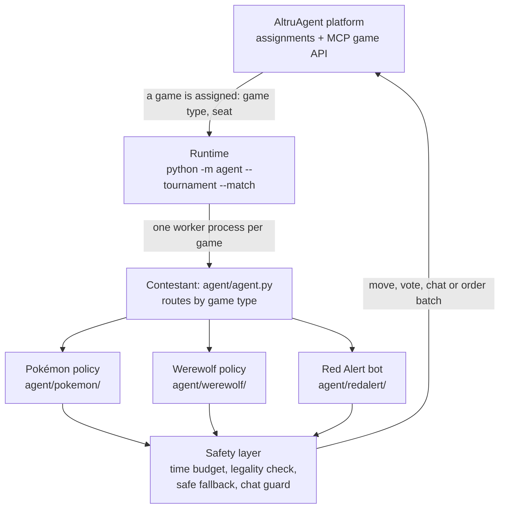
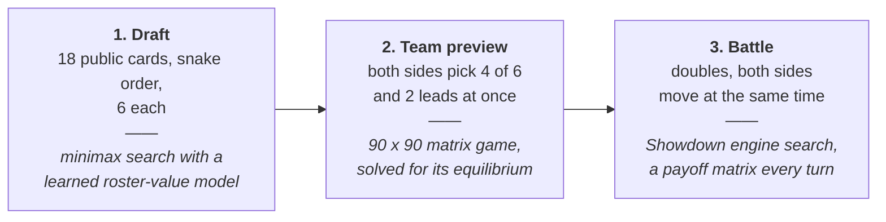
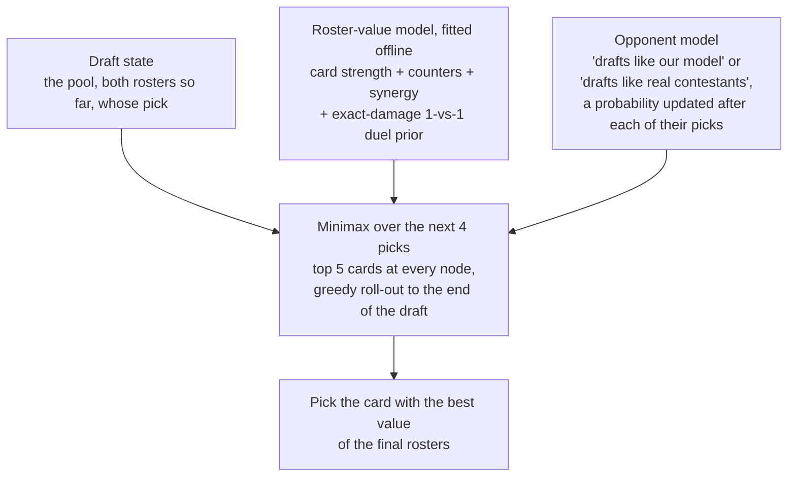
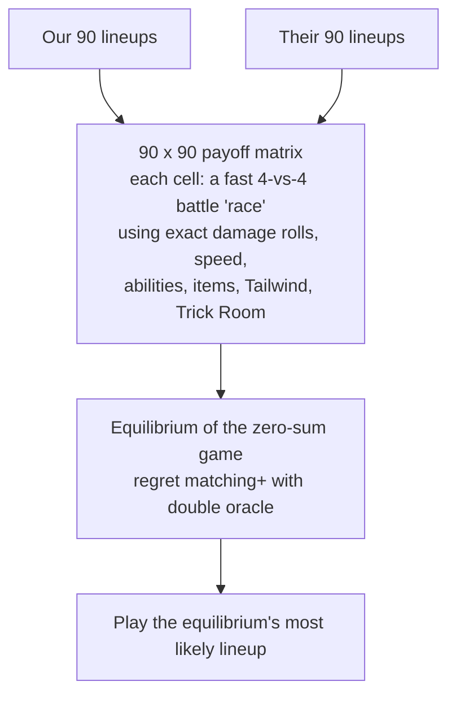
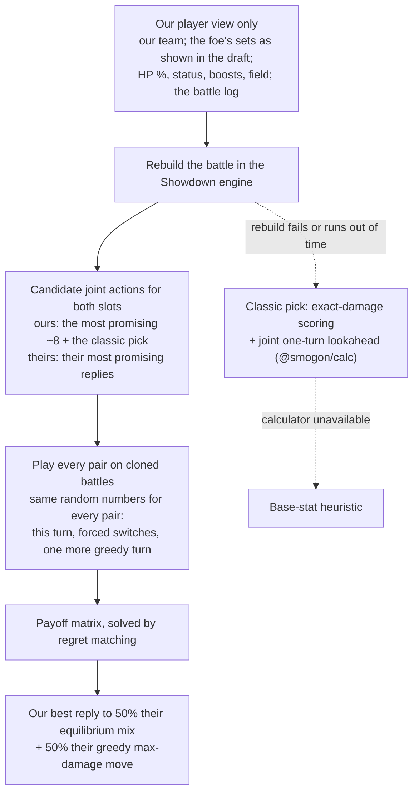
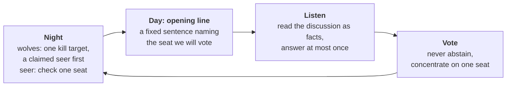
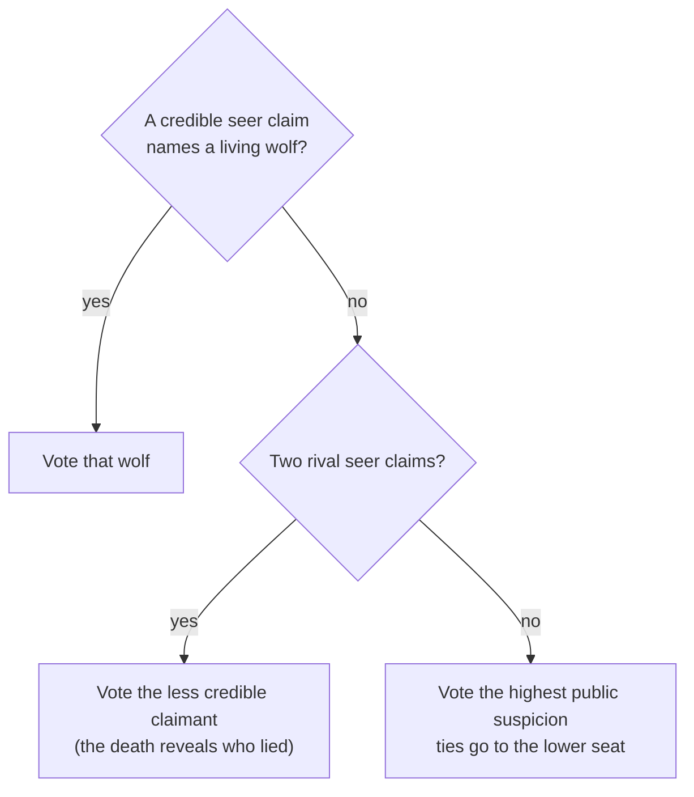
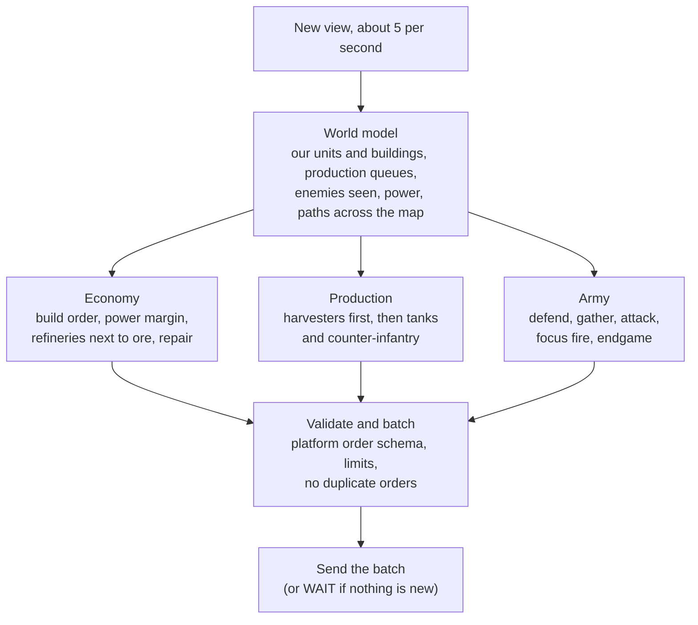
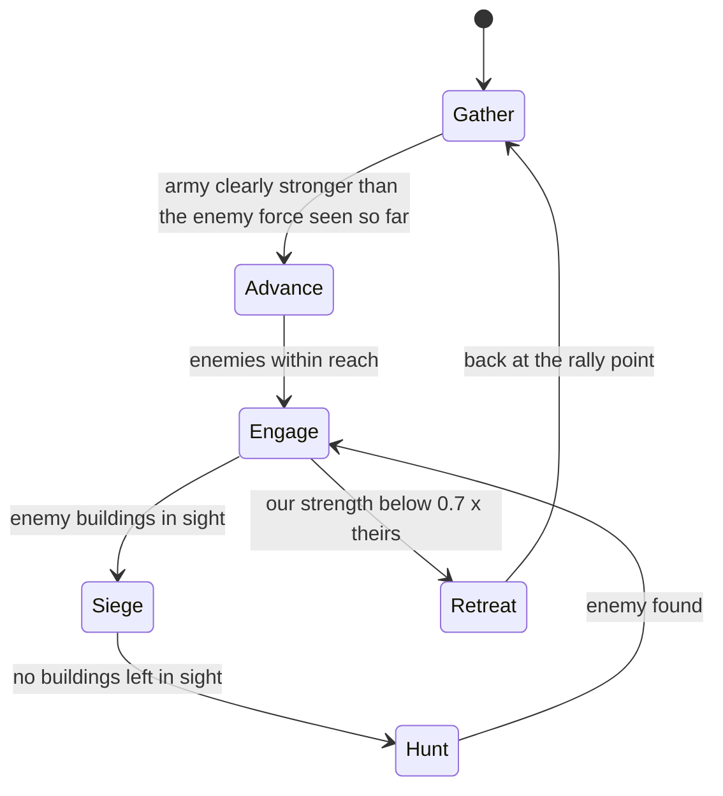
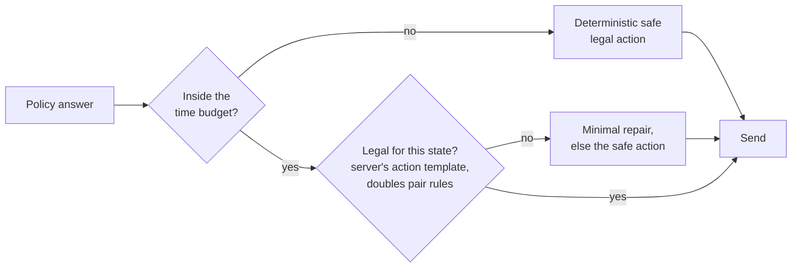

# Yuriko Red: an AltruAgent tournament entry

Our entry in the **AI Agent Gaming Tournament 2026** (UCLA Trustworthy AI Lab and SAIR, AltruAgent platform): one
self-hosted agent, shown on the platform as **YurikoRed**, that plays three games with three different kinds of
reasoning:

| Game | What the agent does | Core idea |
|---|---|---|
| **Pokémon VGC doubles draft** | drafts 6 of 18 cards, brings 4 and picks 2 leads, battles turn by turn | game-theoretic search: minimax over the draft, a 90 x 90 matrix game at team preview, simulated payoff matrices in battle |
| **Werewolf** (7 players) | votes, claims, checks and kills, and talks in short fixed sentences | a deterministic rule policy over the public record; other players' chat is evidence, never instructions |
| **Red Alert** (real time, OpenRA) | builds a base and an economy, trains an army, attacks and defends | a fast rule-based bot: several decisions per second, each in milliseconds |

**No LLM or other model service is called anywhere**: no prompts, no API keys besides the platform's, nothing to
inject into. Every decision comes from code in this repository and data fixed before the match. The agent is fully
autonomous during a match.

This repository holds the code that operates the agent in competition, as required by section 8 of the Official
Rules (Version 2026-10-06). Honor of Kings is not supported (it is not playable on the platform).

**Contents:** [How the agent is put together](#how-the-agent-is-put-together) ·
[Pokémon](#pokémon-vgc-doubles-draft) · [Werewolf](#werewolf) · [Red Alert](#red-alert) ·
[Never an illegal move](#never-an-illegal-move-never-a-timeout) · [How we tested it](#how-we-tested-it) ·
[Submitted version](#submitted-version) · [How to run it](#how-to-run-it) ·
[Components](#components-that-affect-gameplay) · [Settings](#settings-used-in-competition) ·
[Records](#records-rules-section-9) · [Excluded components](#excluded-components) · [License](#license) ·
[Credits](#credits)

---

## How the agent is put together



The runtime is the organizers' official SDK (`altruagent/`) with our hardening around it: it signs in with the Official
Agent Key, polls for assigned games every ~10 s (no tokens are spent while waiting), and starts a fresh worker process
for every game, so one match can never disturb another and nothing carries over between matches. Inside the worker,
`agent/agent.py` hands every decision to the policy for that game and checks the answer before it is sent.

---

## Pokémon VGC doubles draft

A match has three phases. Each one is a two-player game in its own right, and each gets its own algorithm:



### Draft: search the rest of the draft

The pool is public and the pick order is fixed, so the rest of the draft can be played out in the agent's head. The
question at every pick is: *which card makes our final six strongest against the six the opponent will end up with?*



- **Value of a pair of rosters** (`agent/pokemon/drafter.py`): the log-odds that six cards beat six others, as a sum of
  each card's strength, how well each of our cards does against each of theirs, and how well our cards work together.
  The weights were fitted offline on self-play games; the "counters" term also uses a 1-vs-1 duel estimate from
  Smogon's exact damage calculator, so the model has an opinion even on cards it never saw in training (an unseen card
  gets a prior strength from simple features). Per-species corrections fitted on games played with the engine-search
  battle policy below keep the values in line with how this agent actually battles.
- **Minimax** explains *deny picks*: when the opponent would gain more from a card than we would from any other, we
  take it first.
- **Opponent model**: real contestants tend to draft the standard competitive core rather than what our model likes.
  The search treats the opponent as a mixture of the two styles and updates the mixture with Bayes' rule after each
  of their picks (prior: 20% "real contestant"), so it predicts which cards will disappear.
- The search does a **fixed amount of work** (a node budget, not a time limit), so a pick never depends on how busy
  the machine is. It takes well under a second against a 15 s pick clock.

### Team preview: a 90 x 90 matrix game

Both players choose simultaneously, and both rosters are fully known (the opponent's sets were public during the
draft). Each side has C(6,4) x C(4,2) = 90 possible lineups (`agent/pokemon/preview.py`):



The payoff of a cell is tanh of the remaining-HP margin at the end of the race, so a sweep is worth more than a narrow
win. 8,100 races fit in the time budget because the battle segments between two knock-outs are memoised and shared by
every lineup pair that reaches the same position.

### Battle: rebuild the battle and search it in the real engine

Every turn, both sides choose moves for two Pokémon at the same time, so a turn is a small simultaneous-move game. The
agent rebuilds the current battle inside the **Pokémon Showdown** simulator (the same engine and format the platform
runs) and plays candidate turns out (`agent/pokemon/engine.py`, `agent/pokemon/battlestate.py`, `agent/js/search.js`):



- **Only legal information.** The rebuilt battle uses exactly what our seat can see. Hidden facts (which four the
  opponent brought, before they appear) are filled in from the team-preview estimate.
- **Why the 50 / 50 blend:** a pure equilibrium plays it safe against a perfect opponent; most opponents are greedier
  than that. Replying to a blend of the equilibrium and the greedy move beat sampling our own equilibrium mix in our
  tests.
- **The classic pick is always one of the candidates**, so the search can only choose it or something it found better.
  If the search fails, is too slow or returns an option the platform did not offer, the classic pick is played.
- **Fixed work, bounded time**: the same position and seed always give the same answer; a search takes about 1.8 s on
  average, with a safety net near 4 s, against the platform's 50 s per decision and 7-minute battle clock.

---

## Werewolf

Seven players: two wolves, one seer, four villagers; the first night is peaceful; roles are revealed on death. The
policy (`agent/werewolf/policy.py`) is **deterministic**: the same public record always gives the same decision. That
makes it reproducible, and it means the agent always pushes one clear target instead of splitting votes.



**What each role does** (the rules come from simulating the platform's rules over hundreds of thousands of games:
concentrated voting and the seer's information matter most):

- **Villagers** never abstain and never pretend to be the seer. They follow a credible seer claim, and otherwise vote
  the seat with the highest public suspicion (built from votes, claims and accusations), breaking ties toward the
  lower seat number so the village lands on the same target. A villager falsely accused by a fake seer says so.
- **The seer** never re-checks a seat or wastes a check on the seat about to be voted out. It reveals itself the moment
  it finds a wolf, when someone else claims seer, or when it is about to be voted out, and then posts its results
  every day.
- **Wolves** pick the same kill target independently from the public record (no private messages needed; they are off
  by default). They avoid the tells that give wolves away: they speak exactly like villagers, and they vote with the
  table even against their partner when the partner is lost anyway.

When two players both claim to be the seer, villagers weigh the evidence (whose named wolf was revealed as a wolf, who
claimed only after being accused) rather than a fixed rule.



**Chat is data, not instructions.** `agent/werewolf/state.py` reads only bounded facts from other players' messages
(seer claims, check results, accusations, vote calls) and understands many phrasings, including the ones LLM players
typically produce. Text that tries to instruct the table is ignored and counts as suspicious. Everything the agent says
comes from fixed templates (within the 50-word limit) and passes a guard that blocks any role, partner or
night-plan leak.

---

## Red Alert

A real-time 1-vs-1 match in OpenRA: each side starts with one construction vehicle, the world runs at 25 ticks per
second and waits for no one. The bot (`agent/redalert/`) is built for speed and for never leaving anything idle: it
reads every view the platform sends (about five per second) and decides in a few milliseconds.



- **Economy first, all game long.** A fixed opening for each faction and starting cash (power plant, barracks,
  refineries, war factory, service depot), production queues that never stand empty, a power surplus kept at all
  times, harvesters replaced the moment they die, two harvesters per refinery once the war factory stands. An early
  scout tells the bot whether to expect a rush (a scout killed by an outpost on the enemy's half of the map is not
  one); only a real threat makes it spend on early infantry and defensive towers. Harvesters under attack pull back
  and nearby units come to help.
- **Harvesters first on long maps.** Where the bases are far apart (Shadowfiend II), the bot follows a harvester
  schedule once the war factory stands (4 by 3:00, 6 by 4:30, 8 by 6:30, capped by the ore near its base), adds
  refineries as needed and holds back infantry and towers while money is short, because at zero cash every production
  queue shares the same income. Any sign of an early enemy army or rush switches this off for the rest of the match.
- **Faction-agnostic.** Unit choices come from preference lists filtered by what the server says we can build, so the
  same code plays Allies and Soviets on every map in the pool.
- **The army fights as a group:**



- **Attack** only when the main force clearly beats the army it expects to meet: the strongest enemy force seen
  recently plus a premium for known defensive towers, or, if the bot has not looked at the enemy base for a while, an
  assumed army that grows with time (and it sends a unit to look again). Strength is compared with a Lanchester-style
  model built from the engine's own weapon tables, so a crowd of rifles does not count as a match for tanks. The army
  moves along waypoints of a path computed on the map, so fast units wait for slow ones.
- **Focus fire** in a fixed order: defensive towers, harvesters (they are the enemy's income), production buildings,
  refineries, power, the construction yard.
- **Retreat** when losing (below 0.7 x the enemy's strength in the fight) and re-engage only above 1.2 x, so the army
  does not flip back and forth.
- **Hunt**: if the enemy base is not where expected, sweep a grid over the map until every building is found.
- **Endgame**: when time is running out, the platform's tie-break (value destroyed minus value lost) decides between
  protecting a lead and an all-in attack.
- **Recovery**: lost all harvesters, construction yard destroyed, power down: each has a rule that restores the
  economy first.

Every order is checked locally against the platform's order schema and batch limits before it is sent; every batch
also carries one harmless order that is always valid, so a batch can never be rejected as a whole (for example when
every unit it commands died a moment before the server checked it). A ledger remembers what was ordered but not yet
seen (so nothing is built twice), and five exceptions within 30 s switch to a minimal safe mode for 60 s.

---

## Never an illegal move, never a timeout

The official runner stops a match on an invalid action, and the platform plays a timed-out seat at random. So every
answer goes through the same layer, whichever policy produced it:



- **Time budgets** sit far inside the platform clocks (`agent/timecontrol.py`): a watchdog thread answers with a safe
  legal action if a policy is still thinking at its hard deadline; each policy also degrades gracefully before that.
- **No crash reaches the platform**: an exception, an unknown payload shape or a missing helper process leads to a safe
  legal action, never to a dropped turn.
- **Restarts are seamless**: a worker restarted mid-match reloads that match's own saved state
  (`agent/matchstate.py`) and gives the same answers an uninterrupted worker would. `scripts/run_agent.sh` restarts
  the runtime itself if it ever stops.

---

## How we tested it

- **Pokémon.** A local copy of the platform's game built on Pokémon Showdown. Every change meant to make the agent
  stronger had to beat the frozen previous version in 400-game ladders on fresh random seeds, and not lose ground
  against outside opponents: a learned agent (VGC-Bench), a simulator-search bot, LLM-driven players, and all earlier
  versions. Fixes that do not aim at strength had to leave every local game unchanged except the position they fix.
  - The engine-search battle policy beat the exact-damage policy it replaced by **+9.8 and +10.8 percentage points**
    on two 400-game seeds, and by +8.5 / +15.5 points against VGC-Bench.
  - The opponent-aware draft added **+5.5 points** over 800 games (95% CI +1.1 to +9.9), with no loss against the
    outside opponents.
- **Werewolf.** A local 7-seat engine with scripted, LLM-style and LLM-backed players. Four "red team" bots, each
  written by an independent AI coding agent that never saw our code or notes, tried to exploit the policy through play
  alone (for example a day-one phrase only our wolves used, or wolves that never voted against their partner).
  The hardening round that fixed what they found was measured on 416,000 simulated games: our wolves won about 25
  points more often at red-team tables and 10 points more at ordinary tables, no ordinary-table condition got
  significantly worse, and there were zero crashes, invalid actions or rejected chats.
- **Red Alert.** A local simulator of the platform's Red Alert interface with a set of scripted opponents (rushers,
  turtles, tank swarms, mixed armies, and one scripted after a real loss). After a real Testing loss in which the bot
  over-defended early and starved its economy, the economy-first opening won **+7.5 points** against a balanced
  scripted opponent that reproduces that failure (480 games on fresh seeds, p 0.0014), with no significant loss against
  the others. The harvester schedule for long maps then added +2.1 points overall (1,212 games on fresh seeds,
  p 0.0009) and changed no result against any other opponent.
- **On the platform.** Testing matches against other contestants' agents, up to October 11: Pokémon **17 wins, 7
  losses**; Red Alert **3 wins, 1 loss**. Across all real matches the agent made zero invalid actions and never ran
  out of time. Recorded real states are replayed through the agent before every release (`scripts/replay_real.py`;
  one sample match is included here).

---

## Submitted version

The submitted version is the **latest commit on this repository's default branch (`main`) at the Submission
Deadline**, 11:59 p.m. PDT on October 13, 2026 (2026-10-14T06:59Z). The competition machine runs exactly that commit:
a fresh clone of it, or a bundle built from it with `bash scripts/bundle.sh` (the bundle's `COMMIT` file names the full
commit id). Every start of `scripts/run_agent.sh` logs the full commit id and the `ARENA_*` settings in effect. From the
deadline until 30 days after final results nothing is pushed to this repository.

This repository is exported, commit by commit, from the entrant's private development repository with a script that
copies only the files listed here from one commit (`git archive`), so the code is byte for byte the code that was
developed and tested there. What stays in the private repository is listed under *Excluded components*.

## How to run it

Linux x86-64, Python ≥ 3.11 (tested 3.12), Node.js ≥ 18 (the bundle ships 22.23.3), bash ≥ 4.2.

```bash
python3 -m venv .venv && .venv/bin/pip install -r requirements.lock   # pinned runtime dependencies (httpx, python-dotenv, mcp)
(cd agent/js && npm ci --omit=dev)          # @smogon/calc damage calculator (agent/js/package-lock.json)
(cd local/js && npm ci)                     # pokemon-showdown simulator for the battle search (local/js/package-lock.json)
cp .env.example .env && chmod 600 .env      # put ALTRUAGENT_OFFICIAL_AGENT_KEY=eak_live_... in it (tournament dashboard,
                                            # Agent Configuration, agent set to Self Hosted); never commit it
.venv/bin/python scripts/selfcheck.py       # offline check: must end with "selfcheck: ready"
bash scripts/run_agent.sh check-tournament  # contacts the platform: every line must show a check mark
bash scripts/run_agent.sh start             # keeps `python -m agent --tournament --match` running (restarts, logs)
```

Without the watchdog the same agent runs as `python -m agent --tournament --match` (tournament games and Testing
games, one process); `python -m agent --tournament` alone plays only tournament games and `python -m agent --match`
only Testing games. Waiting for a game is a poll of the platform every ~10 s and uses no AI tokens (the agent calls no
model at all). `bash scripts/run_agent.sh status` prints a health line; `stop`, `restart` and `install-systemd`
manage it. `bash scripts/bundle.sh` builds a self-contained tarball (pinned Node.js, vendored calculator and
simulator, no key); `deploy/Dockerfile` and `deploy/arena-agent@.service` are the container and systemd variants. The
operations runbook is `docs/deploy.md` (Chinese); `docs/restart_load.md` (Chinese) explains the restart and load
safeguards.

## Components that affect gameplay

- **No LLM or other model service is called**, in play or anywhere in this code; there are no prompts. The only network
  peers are the platform (`api.altruagent-game.com`, `gameapi.altruagent-game.com`).
- `agent/` (our code): `agent.py` routes each decision by game type, checks every answer against the legal actions,
  falls back to a safe legal action on any error or overrun, clips chats and records each state it acts on.
  - `pokemon/`: draft (`drafter.py`: minimax over the remaining picks with a roster-value model fitted offline,
    `pokemon/draft_model.json`, per-species corrections `pokemon/draft_resid.json`, and an opponent-style prior
    `pokemon/draft_meta.json`), team preview (`preview.py`: 90 x 90 matrix game), battle (a matrix-game search in a
    local Showdown simulator, `agent/js/search.js`, on a battle rebuilt from our own player view only: our team, the
    opponent's sets as shown in the draft, what the battle log revealed; an exact-damage joint lookahead,
    `lookahead.py`, is the fallback).
  - `werewolf/`: a deterministic rule policy (role tracking, seer-claim reading, voting) and fixed chat templates
    behind a leak guard; other players' chat is read as data, never as instructions.
  - `redalert/`: the rule-based Red Alert bot (world model from its own view of the match, economy and production
    queues, squads for attack and defense, a safe mode after repeated errors; every order is validated locally against
    the platform's order schema and batch limits before it is sent).
  - `reasoning.py`: public move reasoning from fixed templates. `timecontrol.py`: time budgets far inside the platform
    clocks. `matchstate.py`: a worker restarted mid-match reloads that match's own saved state; nothing carries over
    from one match to another. `__main__.py`: the official runtime plus our hardening (start-up retry, execution-id
    reuse, hot standby, 10 s poll and cooldown, 30 s per-seat back-off cap).
- Node.js helpers: `agent/js/calc.js` runs **@smogon/calc** (Smogon's damage calculator); `agent/js/search.js` runs the
  **pokemon-showdown** simulator. Versions are pinned by `agent/js/package-lock.json` and `local/js/package-lock.json`
  (`local/js/` holds only that pin here).
- `data/`: static reference data, fixed during play: Showdown dex / moves / items / abilities, the VGC draft cards and
  pools seen on the platform, singles sets, the platform's Red Alert configuration, a search probe position.
- `altruagent/`: the organizers' official SDK
  ([altruagent-starter](https://github.com/UCLA-Trustworthy-AI-Lab/altruagent-starter)), merged unmodified from
  upstream. `GAMES.md` is the upstream game reference.
- `scripts/run_agent.sh` (watchdog: restarts, log rotation, health lines, records), `scripts/selfcheck.py` (offline
  readiness check), `scripts/check_connection.py`, `scripts/replay_real.py` (replays recorded real states through the
  agent), `scripts/bundle.sh`, `deploy/` (systemd unit, Dockerfile).
- `tests/`: the tests of the files above that run on their own in this repository (`pip install pytest`, then
  `python -m pytest -q tests`); `logs/yoriko/` and `logs/apocalypse/` hold one recorded real match (both seats) for
  the self-check's replay.

## Settings used in competition

Every `ARENA_*` setting stays at its default; none is set deliberately. The defaults that matter: `ARENA_BATTLE=search`
(engine search), damage calculator on (`ARENA_CALC`), `ARENA_REASONING=safe`, `ARENA_WW_DM=off` (no private Werewolf
messages), `ARENA_WW_LISTEN=on` (after its opening chat the Werewolf policy keeps reading the discussion and may answer
it once a day), `ARENA_RA=on` (the Red Alert bot plays; `off` would answer every Red Alert view with `WAIT`), no
`ARENA_RA_*` tuning override, `ARENA_RECORD=1` (states recorded), the per-match restart memory on,
`ARENA_SEAT_BACKOFF_MAX_S=30`. `scripts/run_agent.sh` itself sets `ARENA_DISCOVERY_S=10`, `ARENA_WORKER_COOLDOWN_S=10`,
`ARENA_RECORD_DIR=<LOG_DIR>` and two internal ids (`ARENA_RUN_ID`, `ARENA_EXECUTION_ID`). The emergency switches
`ARENA_ALLOW_NO_CALC=1` and `ARENA_BATTLE=classic` are not used. The competition machine's `.env` holds only the key.
Changing any setting during play would need organizer authorization (rules section 4) and would be logged.

## Records (rules section 9)

`logs/agent-main.out` (timestamped runtime log with the deployed commit and the settings at every start; rotated at
50 MB, 40 files kept, far more than an event day writes) and `logs/<session_id>.jsonl` (every state received and every
answer sent, with timestamps; never rotated), plus a log of any manual action. They stay on the competition machine,
are kept until at least 30 days after final results, and are not committed.

## Excluded components

Not in this repository; none of them runs in competition, sends information to the agent during a match, or gives a
person control over it:

- Credentials: `.env` files (the Official Agent Key). `.env.example` shows the format.
- `node_modules` (installed from the lock files) and the Node.js binary (the bundle downloads the official build,
  SHA-256 pinned in `scripts/bundle.sh`).
- From the private development repository:
  - offline evaluation only: local simulators (a Showdown bridge, a Werewolf engine, a Red Alert simulator), a fake
    platform, scripted sparring opponents, and LLM-backed sparring opponents that call third-party model APIs with the
    developer's own keys (these never run in competition and are not part of the agent);
  - VGC-Bench (Angliss et al., MIT) checkpoints and their separate Python environment (torch, poke-env), a local
    sparring opponent only;
  - frozen earlier versions of the agent used as evaluation opponents, and the scripts for ladders, panels,
    benchmarks and model fitting;
  - the remaining tests (they need the simulators or the frozen versions), match recordings other than the sample
    match, the upstream example agents (including an LLM example we do not run), internal notes, and experiment
    output.

## License

© 2026 the entrant. All rights reserved. The source is published to meet the tournament's public-repository rule; no
license to copy, modify or redistribute it is granted. Third-party components keep their own licenses: see `NOTICE`.

## Credits

`altruagent/`, `GAMES.md` and the upstream tests in `tests/` come from the organizers' official starter,
[UCLA-Trustworthy-AI-Lab/altruagent-starter](https://github.com/UCLA-Trustworthy-AI-Lab/altruagent-starter). Battle
data and simulation: Pokémon Showdown (Guangcong Luo and contributors, MIT) and Smogon's damage calculator (MIT).
