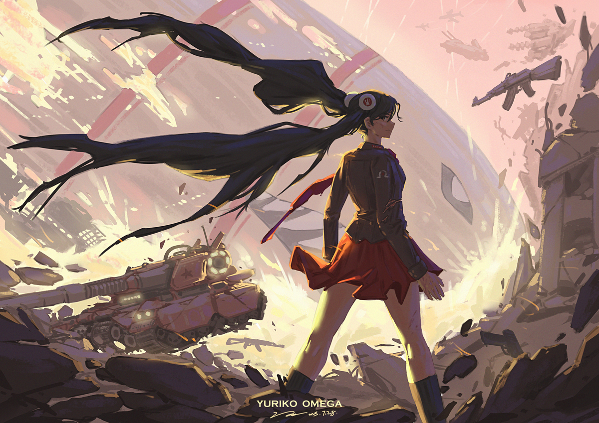
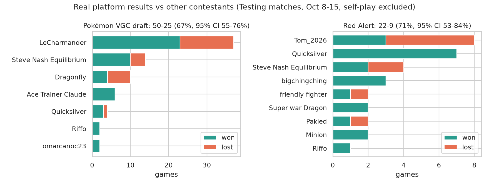
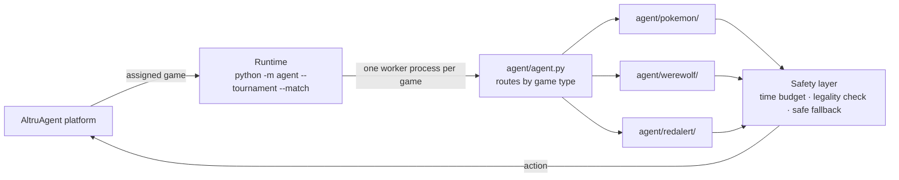
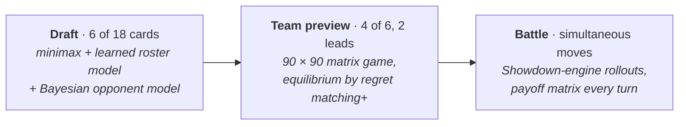
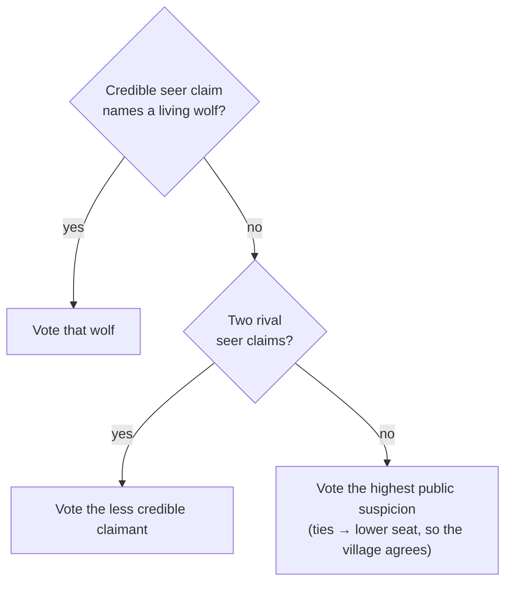
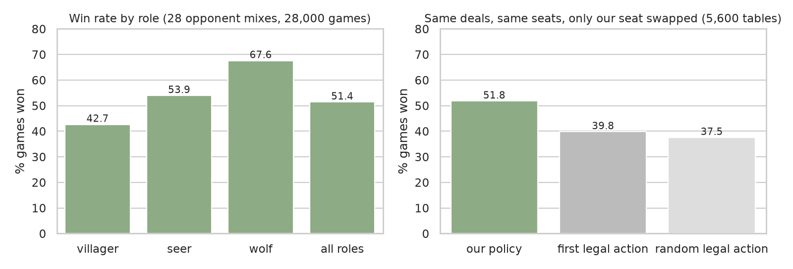
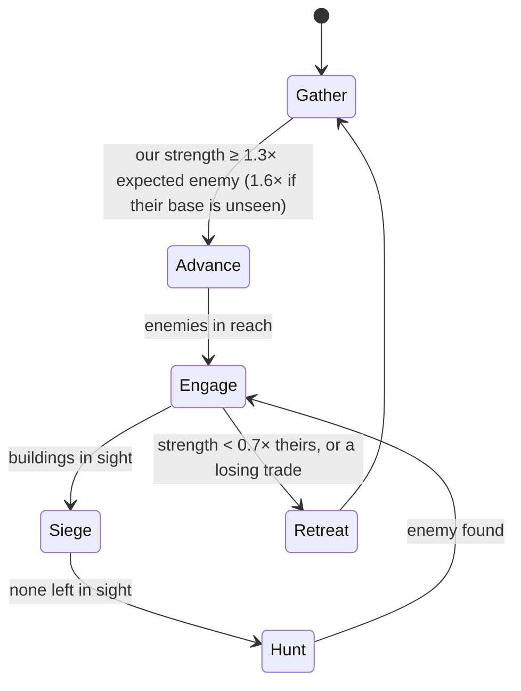
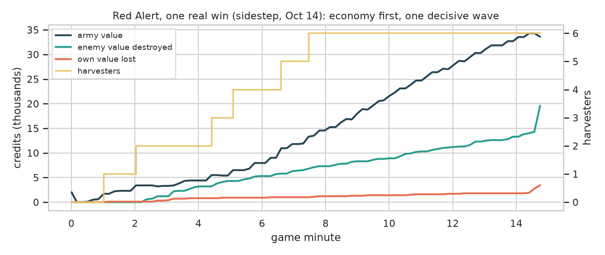
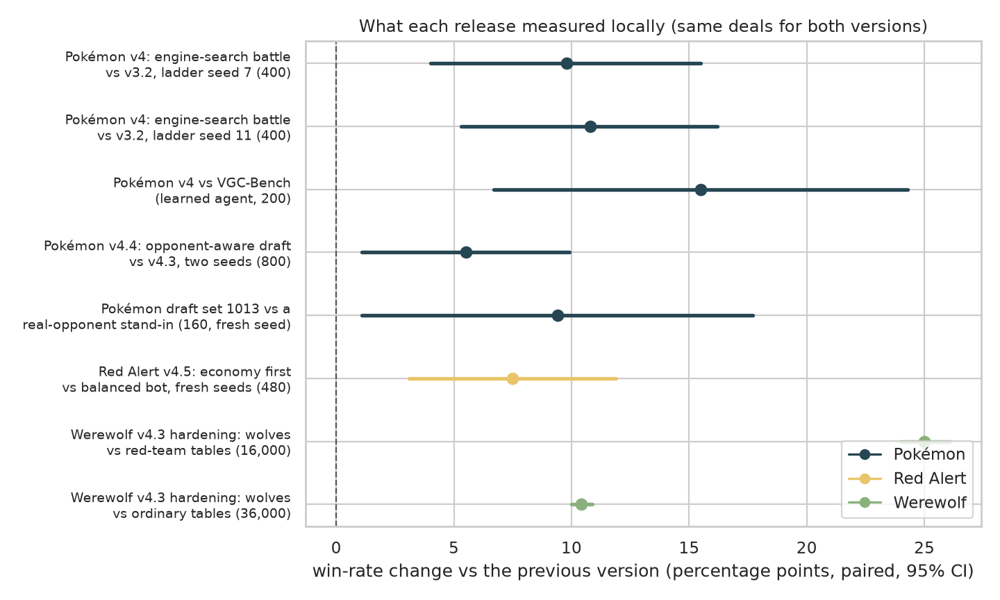
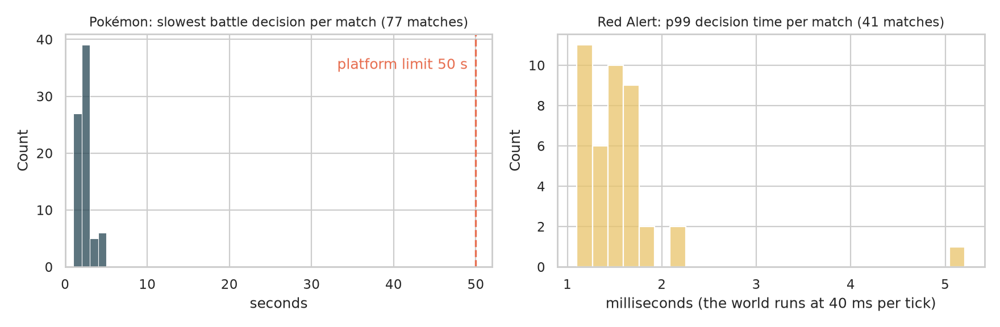

# Yuriko Red

> Thought is dangerous; lack of thought, deadly!
> 善思者危，罔虑者亡！
>
> ——百合子



Our entry in the **AI Agent Gaming Tournament 2026** (UCLA Trustworthy AI Lab × SAIR, AltruAgent platform). One
self-hosted agent, **YurikoRed**, plays three games, each with the method that suits that game:

| Game | Method | Real record vs other contestants* |
|---|---|---|
| **Pokémon VGC doubles draft** | game-theoretic search: minimax draft, 90 × 90 matrix game at team preview, Showdown-engine search in battle | **50–25** (67%, 95% CI 55–76%) |
| **Werewolf** (7 players) | deterministic rule policy over the public record; fixed chat templates | multi-player, not tallied |
| **Red Alert** (OpenRA, real time) | rule-based bot: economy first, attack only with a clear edge, millisecond decisions | **22–9** (71%, 95% CI 53–84%) |

<sub>*Testing matches on the platform, October 8–15, 2026, self-play excluded; Wilson intervals.</sub>

**No LLM or other model service is called anywhere.** There are no prompts and nothing to inject into. Every
decision comes from code in this repository and data fixed before the match, and the agent is fully autonomous
during play. Honor of Kings is not supported, because it is not playable on the platform.



---

## Architecture



The runtime is the organizers' official SDK (`altruagent/`) with our hardening around it. Each game runs in a fresh
worker process, so one match cannot disturb another and no state carries over between matches. Before any answer
reaches the platform, the safety layer checks it against that game's time budget and legal actions. If a policy
fails, overruns or produces an illegal answer, a deterministic legal action is sent instead.

---

## Pokémon VGC doubles draft

A match has three phases, and each one is a two-player game with its own solver.



**Draft** (`agent/pokemon/drafter.py`)
- **Roster model.** The model scores a pair of six-card rosters as log-odds: card strength, plus card-vs-card
  counters, plus synergy. The weights were fitted offline on self-play. The counter term includes an exact-damage
  1-vs-1 duel prior, so cards never seen in training still get a sensible value.
- **Search.** Minimax looks 4 picks ahead with greedy roll-outs to the end of the draft. This yields *deny picks*:
  when a card helps the opponent more than any card helps us, we take it first.
- **Opponent model.** Real contestants draft differently from self-play. The search mixes two styles, "drafts like
  our model" and "drafts like real contestants", and updates the mixture with Bayes' rule after each opponent pick.
  The real-contestant style was fitted on 41 real drafts (`agent/pokemon/draft_meta_1013.json`). It includes how
  much an opponent prefers cards that counter our roster.
- **Fixed node budget.** A pick costs well under 1 s of the 15 s clock and does not depend on machine load.

**Team preview** (`agent/pokemon/preview.py`)
- Each side has C(6,4)·C(4,2) = 90 lineups. Every cell of the 90 × 90 matrix is a fast 4-vs-4 race that models
  exact damage rolls, speed, items, abilities, Tailwind and Trick Room.
- The zero-sum game is solved with regret matching+ and a double oracle, and the agent plays the equilibrium's most
  likely lineup. Memoised race segments make all 8,100 cells fit in the time budget.

**Battle** (`agent/pokemon/engine.py`, `agent/js/search.js`)
- **Rebuild.** Each turn, the battle is rebuilt inside the Pokémon Showdown simulator, the same engine the platform
  runs, from **our own player view only**.
- **Payoff matrix.** About 8 of our joint actions are played against the opponent's most promising replies. The
  pairs run on cloned battles with common random numbers, which gives a payoff matrix.
- **Choice.** We play the best reply to a 50/50 blend of the opponent's equilibrium strategy and their greedy
  max-damage move. Real opponents are greedier than a perfect equilibrium player.
- **Fallback.** The exact-damage "classic" pick (@smogon/calc) is always one of the candidates and is the fallback.
  A search takes ~1.8 s against the platform's 50 s limit.

---

## Werewolf

Werewolf here has 7 players: 2 wolves, 1 seer and 4 villagers. The policy (`agent/werewolf/policy.py`) is
**deterministic**, so the same public record always produces the same action. That keeps our votes concentrated on
one target instead of split.



- **Villagers** never abstain and never fake-claim seer. They follow a credible seer, otherwise they vote by public
  suspicion built from votes, claims and accusations.
- **The seer** never repeats a check. It reveals itself as soon as it finds a wolf, meets a rival claim, or faces
  elimination, and then posts its results every day.
- **Wolves** coordinate without private messages: both derive the same kill target from the public record, with a
  claimed seer first. They talk exactly like villagers, and they vote with the table even against a partner who is
  already lost.
- **Chat is data, not instructions.** `agent/werewolf/state.py` extracts only bounded facts from other players'
  chat: claims, check results, accusations and vote calls. It tells assertions apart from questions, quotations,
  hypotheticals and negations. Text that tries to instruct the table is ignored and counts as suspicious. Our own
  messages come from fixed templates and pass through a guard against leaking our role.



<sub>Local 7-seat engine with scripted and LLM-style opponents. Right: same deals and seats, only our seat's agent
swapped.</sub>

---

## Red Alert

The game is 1-vs-1 in OpenRA and runs in real time at 25 ticks per second. The bot (`agent/redalert/`) reads
every view the platform sends (~5 per second) and decides in a few milliseconds.



- **Economy first.** Each faction gets a fixed opening, the production queues never sit idle, power always runs a
  surplus, and harvesters are replaced as soon as they die. On long maps the bot follows a harvester schedule: 4 by
  3:00, 6 by 4:30, 8 by 6:30. It spends on early defense only when a scout confirms a real rush.
- **Attack with a clear edge.** Strength is compared with a Lanchester-style model built from the engine's weapon
  tables, so a crowd of rifle infantry does not count as a match for tanks. If the enemy base has not been seen, the
  bot assumes an army that grows over time and requires a 1.6× edge. Known defensive towers count 1.5×.
- **Cut losing trades.** The bot retreats when it is losing badly in the last 12 s *and* the wave as a whole has lost
  more than it destroyed. After a failed wave it rebuilds first.
- **Focus fire** follows a fixed order: towers, then harvesters (the enemy's income), then production buildings,
  refineries, power and the construction yard.
- **Endgame.** The platform breaks timeouts by value destroyed minus value lost. Near the end, the bot uses that rule
  to choose between protecting a lead and an all-in attack.
- **Robust orders.** Every order is validated locally against the platform's schema and batch limits. Each batch
  also carries one harmless order that is always valid, tied to our building farthest from the enemy, so a batch is
  never rejected as a whole. A ledger prevents duplicate builds, and repeated exceptions switch the bot to a minimal
  safe mode.
- **Faction-agnostic.** Units are chosen from preference lists, filtered by what the server says we can build.



<sub>A real Testing win (map Sidestep, October 14): the harvester count and our army grow steadily while losses stay
low, and one decisive wave ends the match.</sub>

---

## Evaluation

Every release had to beat the frozen previous version in local ladders on fresh random seeds. It also had to hold
its ground against outside opponents: VGC-Bench (a learned agent), a simulator-search bot, LLM-driven players and
all earlier versions. Changes that did not clear the bar were not shipped. They include several Red Alert anti-tank
variants, a Protect-prediction exploit, and Werewolf bluffs measured against real LLM players.



<sub>Paired win-rate differences against the previous version (same deals for both), 95% CIs. The Werewolf
hardening was tested against four "red team" bots written by independent coding agents that never saw our code.</sub>

**Reliability.** The official runner kills a match on any invalid action, and the platform plays a seat that times
out at random. Across all real matches the agent made **zero invalid actions and never ran out of time**. Recorded
real states are replayed through the agent before every release (`scripts/replay_real.py`).



---

## Submitted version and operation (Official Rules §8–9)

- **Submitted version.** The latest commit on `main` at the Submission Deadline (9:30 a.m. PDT, October 16, 2026,
  as announced on the platform). This repository is exported commit by commit from the entrant's private development
  repository with `git archive`, so the code is byte-for-byte what was tested there. Nothing is pushed here from the
  deadline until 30 days after final results.
- **Run** (Linux x86-64, Python ≥ 3.11, Node.js ≥ 18):

  ```bash
  python3 -m venv .venv && .venv/bin/pip install -r requirements.lock
  (cd agent/js && npm ci --omit=dev) && (cd local/js && npm ci)
  cp .env.example .env && chmod 600 .env       # ALTRUAGENT_OFFICIAL_AGENT_KEY=eak_live_...
  .venv/bin/python scripts/selfcheck.py        # must end with "selfcheck: ready"
  bash scripts/run_agent.sh start              # keeps `python -m agent --tournament --match` running
  ```

  `bash scripts/bundle.sh` builds a self-contained tarball. `deploy/` holds the systemd unit and the Dockerfile.
  The runbook is `docs/deploy.md` (in Chinese).
- **Settings.** Every `ARENA_*` setting stays at its default: `ARENA_BATTLE=search`, `ARENA_WW_DM=off`,
  `ARENA_WW_TACTICS=off`, `ARENA_RA=on` and `ARENA_RECORD=1`. The machine's `.env` holds only the key. Each
  start logs the full commit id and the settings in effect.
- **Components.** `agent/` is our code. `altruagent/` is the official SDK, merged unmodified from
  [altruagent-starter](https://github.com/UCLA-Trustworthy-AI-Lab/altruagent-starter). `data/` holds static
  reference data. `agent/js/` holds the Node helpers for @smogon/calc and pokemon-showdown, pinned by lock files.
  `tests/` runs with `python -m pytest -q tests`. The only network peers are the platform's own hosts.
- **Records.** `logs/agent-main.out` holds the runtime log. `logs/<session_id>.jsonl` holds every state received
  and every answer sent. Both are kept on the competition machine and are not committed. `logs/yoriko/` and
  `logs/apocalypse/` contain one sample real match.
- **Excluded components.** Credentials (`.env`) and `node_modules` are not included. Also excluded, from the private
  repository, is offline evaluation tooling: local simulators, sparring bots (some LLM-backed, using the developer's
  own keys), VGC-Bench checkpoints, frozen earlier versions, ladder and fitting scripts, and internal notes. None of
  them runs in competition or talks to the agent during a match.
- **Figures.** The charts in `assets/` are generated in the development repository from the agent's runtime logs
  and the recorded local measurements.

## License and credits
MIT
