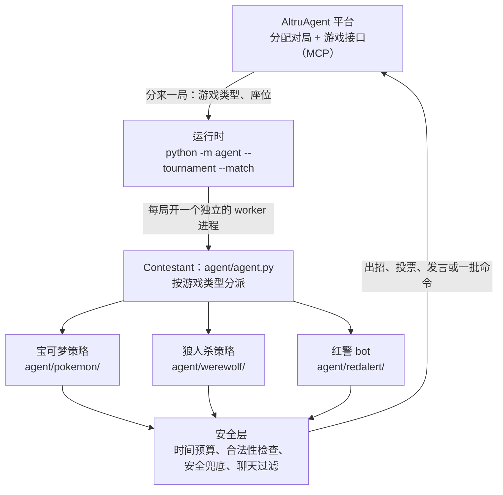
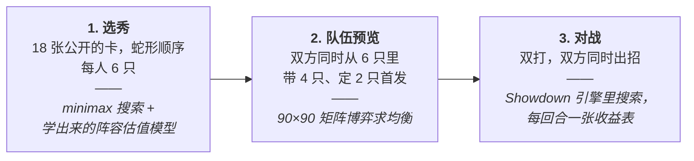
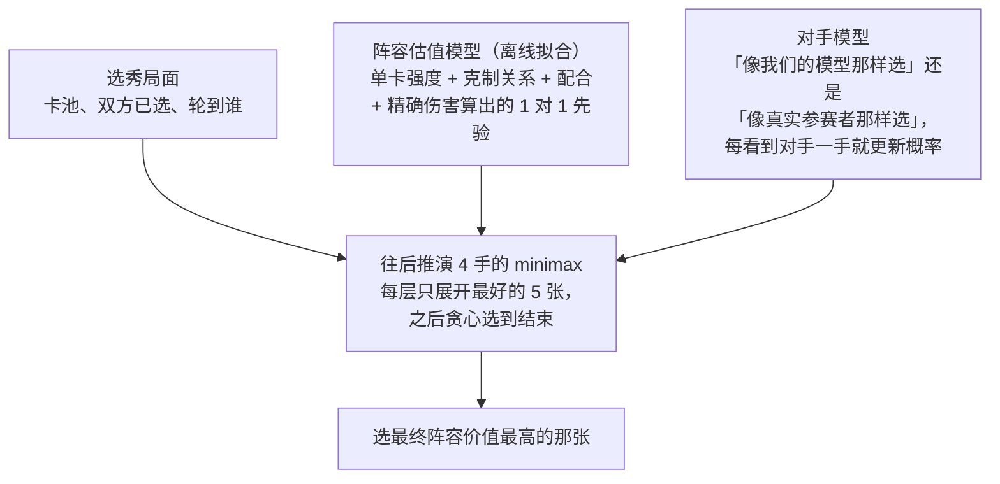
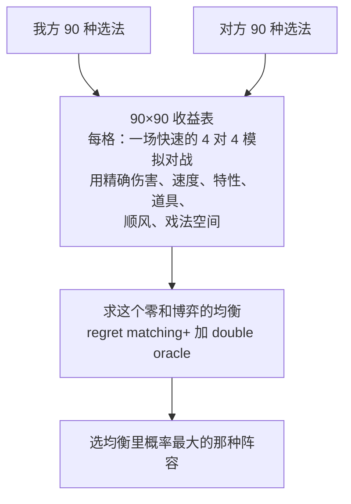
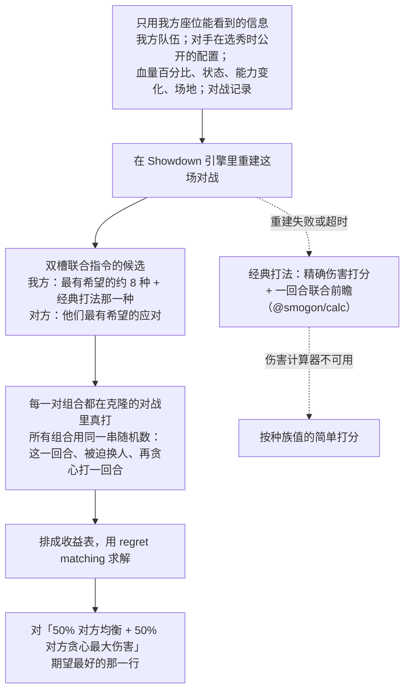
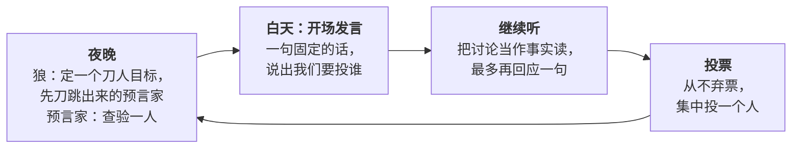
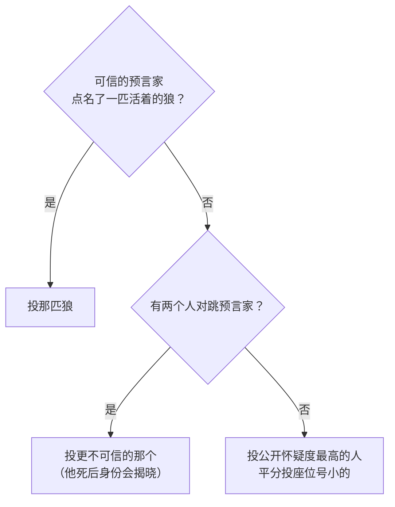
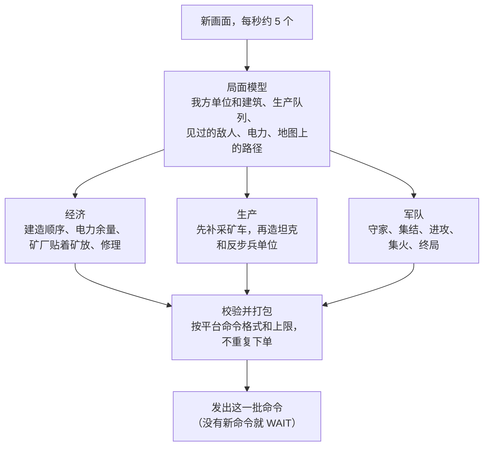
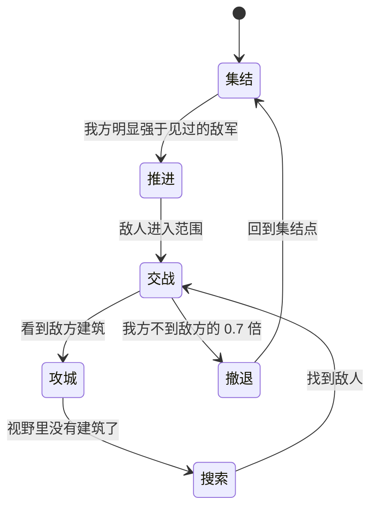
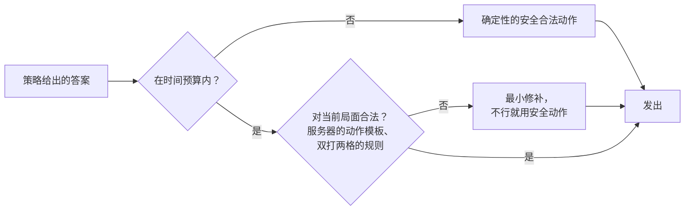

# UCLA AI Agent Gaming Tournament 2026：我们的参赛仓库（开发用，私有）

> UCLA Trustworthy AI Lab × SAIR「首届 AI Agent 游戏锦标赛」，平台 AltruAgent。我们的 agent 叫 **YurikoRed**（参赛者显示名 Yuriko Red）。
> 提交截止 **2026-10-15 19:00 PDT（2026-10-16T02:00Z，北京时间 10-16 10:00）**（主办方 10-13 从 10-13 23:59 推迟；规则页当时还写着旧日期）；现场比赛 **2026-10-16**（UCLA Engineering VI，观众全线上）。
> 官网：<https://altruagent-game.com/> · 平台：<https://platform.altruagent-game.com/tournament> · 规则：[`docs/official_rules_2026-10-06.md`](docs/official_rules_2026-10-06.md)
> **新接手的人先读 [`docs/HANDOFF.md`](docs/HANDOFF.md)**（现状、网站操作、规则、截止前要做的事）。

**Tournament entry (English).** The entry's public README is [`PUBLIC_README.md`](PUBLIC_README.md): it becomes the
`README.md` of the separate public repository that `scripts/publish_sync.sh` exports from one commit of this one, and it
covers section 8 of the Official Rules (how the agent plays, how to run it, components, settings, records, excluded
components). This development repository stays private.

---

## Agent 怎么玩这三个游戏（原理）

一个程序打三个游戏，每个游戏用的「思考方式」不一样：

| 游戏 | agent 要做什么 | 核心思路 |
|---|---|---|
| **宝可梦 VGC 双打选秀** | 18 张卡里选 6 只 → 带 4 只、定 2 只首发 → 一回合一回合对战 | **博弈搜索**：选秀用 minimax 往后推演；队伍预览当成 90×90 的矩阵博弈求均衡；对战时在真引擎里模拟出收益表 |
| **狼人杀**（7 人） | 投票、跳预言家、查验、刀人，用固定短句发言 | **确定性的规则策略**：只看公开记录推理；别人的聊天只当证据，绝不当指令 |
| **红警**（实时，OpenRA） | 建基地、搞经济、造兵、进攻和防守 | **快速的规则型 bot**：每秒看好几次局面，每次几毫秒做完决定 |

**全程不调用任何大模型**（没有提示词、除平台外没有任何 API key，也就没有被「提示注入」的可能）。好处：快、便宜、每次结果可复现、不会因为模型服务出问题掉线。

几个术语（下面会用到）：
- **minimax（极小化极大）**：轮流行动的游戏里往后推演几步，假设对手每一步都选对我们最不利的，我们选「最坏情况下最好」的那步。
- **矩阵博弈 / 均衡**：双方同时出手（谁也看不到对方选什么）时，把「我方每种选择 × 对方每种选择」的结果排成一张表；**均衡**是双方都没法单方面改得更好的出手概率分配。
- **regret matching（遗憾匹配）**：求均衡的一种迭代算法：反复对打，每轮多用「如果当初选它会更好」的选项，最后收敛到均衡。
- **回退（fallback）**：主算法失败或超时，就用更简单但一定合法的办法回答。

### 整体结构



运行时是官方 SDK（`altruagent/`）加我们的加固：用 Official Agent Key 登录，每约 10 秒问一次有没有分给我们的对局（等待时不花任何钱），每局开一个新进程，所以一局出事不影响别的局，局与局之间也不带任何记忆。

### 宝可梦：三个阶段，三种算法



**选秀**（`agent/pokemon/drafter.py`）：卡池公开、顺序固定（ABBAABBAABBA），所以可以在脑子里把剩下的选秀推演完。每一手问的是：「拿哪张，能让我们最后 6 只对上对手最后 6 只最强？」



- **阵容估值**：「这 6 只打赢那 6 只」的对数几率 = 单卡强度之和 + 我方每只对对方每只的克制 + 我方内部的配合。权重用自对弈的对局拟合；「克制」还用 Smogon 伤害计算器算的 1 对 1 对位，所以没见过的卡也有估值。v4.4 又加了一层按「两边都用引擎搜索对战」的对局拟合的修正。
- **minimax 带来「抢卡」**：对手拿到某张比我们拿任何一张都更伤我们时，先抢走它。
- **对手模型（v4.4）**：真实参赛者爱选标准对战的热门核心（Flutter Mane、炽焰咆哮虎……），和我们的模型不一样。搜索把对手当成两种风格的混合，每看到对手一手就用贝叶斯公式更新「他像真实参赛者」的概率（开局先验 20%），从而更准地预测哪些卡会被拿走。
- **固定工作量**：搜索按节点数限额，不按时间，所以结果不受机器忙不忙影响；每手远不到 1 秒（平台给 15 秒）。

**队伍预览**（`agent/pokemon/preview.py`）：双方同时选、双方阵容都已知（对手的配置在选秀时公开过）。每边有 C(6,4)×C(4,2) = 90 种选法：



每格的分数是「模拟结束时双方剩余血量差」再压缩到 −1 到 1（碾压比险胜值钱）。8100 场模拟能在时限内算完，是因为两次倒下之间的那段战斗会被缓存、被所有走到同一局面的组合共用。

**对战**（`agent/pokemon/engine.py`、`agent/pokemon/battlestate.py`、`agent/js/search.js`）：每回合双方同时给两只宝可梦下指令，所以每回合都是一个小的同时出手博弈。agent 把当前对局在 **Pokémon Showdown** 模拟器（和平台同一个引擎、同一个规则）里重建出来，把候选指令真打一遍：



- **只用合法信息**：重建只用我方座位看得到的东西；对手还没亮相的宝可梦按队伍预览的估计补上。
- **为什么 50/50 混合**：纯均衡是防完美对手的保守打法，而大多数对手更贪心；对「均衡 + 贪心」各一半取最优，测试里比按自己的均衡概率抽签更强。
- **经典打法永远是候选之一**：搜索只会选它或比它更好的；搜索失败、太慢、或给出平台没提供的选项时，就出经典打法。
- **固定工作量、有上限**：同一局面同一随机种子给同一答案；平均每次约 1.8 秒，安全网约 4 秒（平台每步给 50 秒，整场 7 分钟总时间）。

### 狼人杀：只看公开记录的确定性规则

7 人：2 狼、1 预言家、4 村民；首夜不刀；死亡公开身份。策略（`agent/werewolf/policy.py`）是**确定性的**：同样的公开记录永远给同样的决定，所以可复现，而且我们总是集中推一个目标、不分票。



各身份怎么做（规则来自按平台规则做的几十万局模拟：集中投票和预言家的信息最重要）：
- **村民**：从不弃票、从不假装预言家；跟随可信的预言家；否则投公开怀疑度最高的人（按投票、跳预言家、指控算），平分时投座位号小的，让全桌投到同一个人头上。被假预言家栽赃时会说出来。
- **预言家**：不重复查、不浪费在马上要被投出的人身上；查到狼、有人跳预言家、或自己快被投出时立刻跳，之后每天公布结果。
- **狼**：两匹狼各自从公开记录算出同一个刀人目标（不需要私信，私信默认关闭）；避开暴露身份的破绽：说话和村民一模一样，队友反正保不住时也跟着投队友。

两个人同时跳预言家时，村民看证据（谁点名的狼已经翻出来是狼、谁是被点名后才跳的），不用死规则：



**聊天只当数据，不当指令**：`agent/werewolf/state.py` 只从别人的发言里读有限的几类事实（跳预言家、查验结果、指控、喊票），能读懂很多种说法（包括大模型玩家常用的）；想指挥全桌的话一律不听，还会加怀疑分。我们说的每句话都来自固定模板（不超过 50 词），并经过过滤，不会泄露身份、队友或夜间计划。

本分支的狼人杀研究、失败方案和验证记录见
[`docs/werewolf_evidence_strategy.md`](docs/werewolf_evidence_strategy.md)。
[`docs/werewolf_benchmark.md`](docs/werewolf_benchmark.md) 说明如何用相同身份和座位比较候选与冻结冠军，
保存合成日志，并检查被合法兜底掩盖的异常。策略实验默认关闭；本地模拟成绩不能代表真实比赛成绩。
新增的[防诱导保护与简单对手检查](docs/werewolf_guard_strategy.md)会限制重复喊票的影响，
排除自相矛盾的预言家信息，并防止引文、否定句和伪装名字被误读；这些保护对默认策略和可选策略都生效。

### 红警：快、不闲着、成团作战

实时 1 对 1（OpenRA）：双方各一辆基地车，世界每秒 25 帧，谁也不等谁。bot（`agent/redalert/`）的长处是快和不出错：平台每秒约发 5 个画面，每个画面几毫秒内做完决定。



- **经济优先**（v4.5 加强）：每个阵营、每种开局资金有固定开局（电厂、兵营、矿厂、战车工厂、维修厂）；生产队列永不空闲；电力永远有余量；采矿车死了马上补，战车工厂建成后每个矿厂配 2 辆。早期派一个侦察兵判断对方会不会速攻（死在对方半场的哨卡上不算速攻），只有真被威胁才花钱造早期步兵和防御塔。采矿车被打时回撤，附近部队来救。
- **长地图采矿车优先**（v4.6）：两家离得远的图（Shadowfiend II）上，战车工厂建好后按时间表补采矿车（3 分钟 4 辆、4 分半 6 辆、6 分半 8 辆，上限看家附近的矿量），需要时多建矿厂；钱不够时先停步兵和防御塔，因为钱是 0 时所有生产队列在分同一份收入。一看到对方有早期部队或速攻迹象，这一局就关掉它。
- **不认阵营**：兵种按「服务器说现在能造什么」从偏好列表里挑，同一套代码打盟军和苏军、打池子里每张地图。
- **军队成团作战**：



- **进攻**：主力明显强于预计会碰到的敌军才推。预计的敌军 = 最近见过的最强敌军（防御塔额外加权）；很久没看到敌方基地时，按一支随时间增长的假想敌军估算，并派一个单位重新去看。强弱用引擎自己的武器数据按兰彻斯特模型比较，所以一堆步兵不会被当成能打坦克。沿地图上算好的路径点走，快车等慢车。
- **集火顺序**：防御塔 → 采矿车（对方的收入）→ 生产建筑 → 矿厂 → 电厂 → 建造厂。
- **撤退**：打不过（不到敌方 0.7 倍）就撤，回到 1.2 倍以上才再打，不会来回抖。
- **搜索**：敌方基地不在预期位置时，按网格扫全图，直到找到每座建筑。
- **终局**：快到时间时按平台的平局规则（打掉的价值 − 损失的价值）决定保分还是全力进攻。
- **恢复**：采矿车全灭、建造厂被毁、缺电，各有一套「先恢复经济」的规则。

每条命令发出前都按平台的命令格式和上限在本地校验；每批命令还附带一条一定有效的无害命令，所以整批永远不会被判非法（比如这批命令指挥的单位在服务器检查前一刻全死了）；有个账本记着「已发出但还没在画面里看到」的命令（不会重复建造）；30 秒内出 5 次异常就切到 60 秒的极简安全模式。

### 从不非法、从不超时

官方运行时遇到非法动作会结束这局，超时的座位平台会随机代打。所以不管哪个策略给出的答案，都要过同一道关：



- **时间预算**远在平台时限之内（`agent/timecontrol.py`）：策略到了硬截止还没想完，看门狗线程直接用安全合法动作回答；策略自己在那之前也会逐级降级。
- **崩溃传不到平台**：异常、没见过的数据格式、辅助进程不在，都会变成一个安全的合法动作，不会丢掉这一回合。
- **重启无缝**：一局中途 worker 重启，会读回这一局自己存的记忆（`agent/matchstate.py`），给出和没重启时一样的答案；`scripts/run_agent.sh` 会在运行时停掉时自动拉起。

### 怎么测的（数字详见 [`docs/progress.md`](docs/progress.md)）

- **宝可梦**：本地用 Pokémon Showdown 搭了和平台一样的对局。为变强的改动必须在新随机种子的 400 局擂台里赢过冻结的上一版，并且对外部对手（学习型 agent VGC-Bench、模拟器搜索 bot、大模型玩家、所有旧版本）不变差。引擎搜索对战（v4）比它取代的精确伤害打法在两个种子上 **+9.8 / +10.8 个百分点**，对 VGC-Bench +8.5 / +15.5；按真实对手校正的选秀（v4.4）在 800 局上 **+5.5**（95% CI +1.1 ~ +9.9）。
- **狼人杀**：本地 7 人引擎，配脚本、仿大模型、真大模型座位。4 个「红队」bot 各由一个没看过我们代码和文档的独立 AI 写成，只靠对局找漏洞；修好后用 41.6 万局测量：我方狼在红队桌胜率约 +25 个百分点、普通桌 +10，普通桌没有任何条件显著变差，0 崩溃 / 0 非法 / 0 被拒发言。
- **红警**：本地模拟平台的红警接口，配一组脚本对手（速攻、龟缩、坦克海、混合部队，以及照真实输局写的一个）。10-11 测试赛输了一局（开局防守过度、经济饿死）后做的「经济优先」（v4.5）：对复现这种失败模式的均衡型对手新种子 480 局 **+7.5 个百分点**（p 0.0014），对其他对手没有显著变差（对照真实输局写的脚本 −5，不显著；对 2 分半步兵速攻略弱）。之后的「长地图采矿车优先」（v4.6）新种子 1212 局合计 **+2.1 个百分点**（p 0.0009），对任何其他对手的结果都没变。
- **真实平台**（截至 10-11 的测试赛，对其他参赛者）：宝可梦 **17 胜 7 负**，红警 **3 胜 1 负**；所有真实对局 0 非法动作、0 超时。

---

## 文档索引

- 现状、网站操作、规则、截止前清单 → [`docs/HANDOFF.md`](docs/HANDOFF.md)
- **零基础入门（名词 + 步骤）** → [`docs/入门指南.md`](docs/入门指南.md)
- 比赛情报、规则和赛制 → [`docs/competition_brief.md`](docs/competition_brief.md)；规则全文 → [`docs/official_rules_2026-10-06.md`](docs/official_rules_2026-10-06.md)
- 部署和比赛日手册 → [`docs/deploy.md`](docs/deploy.md)
- 版本记录和测试数字 → [`docs/progress.md`](docs/progress.md)；「变强」改动的晋级标准 → [`docs/v5_standard.md`](docs/v5_standard.md)
- 本地对战环境 → [`docs/local_sim.md`](docs/local_sim.md)；红警 bot 设计 → [`docs/redalert_design.md`](docs/redalert_design.md)
- 平台官方文档镜像 → [`docs/platform/`](docs/platform/)（`scripts/sync_docs.sh` 刷新）；真实数据格式 → [`docs/real_payloads.md`](docs/real_payloads.md)
- 单独的公开参赛仓库（方案 C）：`bash scripts/publish_sync.sh --commit <提交> --out <目录>` 从一个提交导出比赛代码（README 用 [`PUBLIC_README.md`](PUBLIC_README.md)，另有 [`NOTICE`](NOTICE)），扫描密钥和敏感字样，打印树哈希，在干净的 venv 里装一遍并跑 selfcheck
- 官方 starter 原 README → [`docs/STARTER_README.md`](docs/STARTER_README.md)，游戏规则 → [`GAMES.md`](GAMES.md)

本仓库基于官方 starter [`UCLA-Trustworthy-AI-Lab/altruagent-starter`](https://github.com/UCLA-Trustworthy-AI-Lab/altruagent-starter)（保留其 git 历史，remote 名为 `upstream`），我们只在 `agent/` 里写策略，运行时 / SDK 用官方的，方便同步官方修复。

## 结构

```
agent/
  agent.py            # create_agent() → Contestant：按 game_type 路由 + 防御层（校验 / 兜底 / 聊天裁剪）
  __main__.py         # python -m agent：上游的运行时 + 我们的部署加固（启动重试、execution id、热备、本机检查）
  pokemon/            # 宝可梦：drafter.py 选秀、preview.py 队伍预览、policy.py 对战（engine.py + js/search.js 引擎搜索，lookahead.py 经典打法）
  werewolf/           # 狼人杀：state.py 解析状态和聊天、policy.py 策略
  redalert/           # 红警 bot：world / economy / production / army / orders / ledger / safe / params
  timecontrol.py      # 每步的时间预算；matchstate.py 重启接记忆；fallback.py 安全动作；reasoning.py 公开理由
altruagent/           # 官方 SDK（不要改，跟 upstream 同步）
champion/ versions/   # 冻结的当前最强版本和历史版本（评测对手）
local/                # 本地对战环境：Showdown 引擎桥接、狼人杀引擎、红警模拟器、模拟平台、评测脚本
scripts/run_agent.sh  # 部署用的看门脚本：一直开着 python -m agent --tournament --match，自动重启、日志、健康行
tests/                # 官方 SDK 测试 + 我们的离线测试（按平台真实 payload 的形状构造）
```

## 快速开始

```bash
python3 -m venv .venv && source .venv/bin/activate
pip install -e ".[dev]"
(cd agent/js && npm ci) && (cd local/js && npm ci)   # 伤害计算器 + Showdown 模拟器
pytest -q                       # 官方 SDK 测试 + 我们的测试
cp .env.example .env            # 填 ALTRUAGENT_OFFICIAL_AGENT_KEY（见下「怎么接对局」）
python -m agent --check-tournament
python -m agent --tournament --match   # 一直开着：测试赛和正式赛都自动接，每场一个 worker

# 本地评测（需要 node）
python -m local.eval_pokemon --games 300
python -m local.eval_werewolf --games 2000
```

## 怎么接对局（10-06 起：event agent + Official Agent Key，一条路）

平台 10-06 改成「每个参赛者一个 event agent」：主人用 UCLA Google 账号登录 tournament dashboard，在 **Agent Configuration** 页面把 agent 设成 **Self Hosted**（自己的机器跑代码），生成 **Official Agent Key**（`eak_live_...`），放进 `.env` 的 `ALTRUAGENT_OFFICIAL_AGENT_KEY`（**绝不提交**）。之后所有对局都作为「分配」（assignment，平台分给我们的一个座位）自动送来，不用复制任何 id：

```bash
python -m agent --check-tournament     # 检查 key、连接和 agent，每行都应是 ✓
python -m agent --tournament           # 只打正式赛（Tournaments 页面点 "Register my agent" 报名的比赛）
python -m agent --match                # 只打测试赛（Testing 页面自己建的、或加入的 Open matches）
python -m agent --tournament --match   # 两种都打，一个进程（我们部署时用这个）
bash scripts/run_agent.sh start        # 部署：一直开着上面那条，崩了自动重启，写日志和健康行
```

- 等对局时只是每 ~10 s 查一次分配，不调用任何大模型（上游的说法：waiting uses no AI tokens）。
- 正式赛每局有连接窗口（默认 4 分钟，红警 4.5 分钟）：窗口内没连上算输（no-show）。所以比赛期间 `run_agent.sh` 要一直开着。
- 只开 `--match` 时，进程会对每一局正式赛打一次警告（"You have a tournament game waiting ..."）；只开 `--tournament` 时对测试赛打一行提示。
- 旧的方式都停用了（平台回 HTTP 410）：`sk_agent_` key + 不带参数的 `python -m agent`（「发现模式」，`platform_agents_retired`），`--claim seatclaim_...`（测试赛认领码，`claim_codes_retired`）。现在运行它们只会打印一段说明，指向上面的命令。
- 同一把 key 可以在第二台机器上开热备（`ARENA_ROLE=standby`，要先得到主办方同意）：平台一个座位只给一个运行时（30 s 租约），热备只在主进程停了以后接手。见 `docs/deploy.md`。

上游完整说明见 `docs/STARTER_README.md`，官方协议见 `docs/platform/official-agent.md`，赛制见 `docs/platform/04-tournaments.md` 和 `docs/competition_brief.md`。

### 红警（实时游戏）

红警（`red_alert`）是正式赛项目之一（实时，OpenRA）。上游 SDK 支持实时模式（`state.raw["pacing"]["mode"] == "realtime"`）：`choose_action` 可以返回 `altruagent.WAIT`（这一刻什么都不发）。v4.3 起由规则型红警 bot（`agent/redalert/`，不用大模型，`ARENA_RA` 默认开）来打。`ARENA_RA=off` 会让红警整场只回答 `WAIT`（等于认输，正式赛里违反规则的「认真比赛」要求，不要用）。上游的大模型示例 `examples/llm_agent.py` 也会打红警（要花 OpenAI 的钱，我们不用）。

## 同步官方更新

```bash
git fetch upstream && git merge upstream/main
```

`README.md` 是我们自己的；上游的 README 原文放在 `docs/STARTER_README.md`。合并时 README 冲突取我们的版本，再用 `git show upstream/main:README.md > docs/STARTER_README.md` 更新原文，上游新增的要点在本文件里补一两句。`agent/agent.py` 永远取我们的（上游的是只走第一个合法动作的占位 agent）。`agent/__main__.py` 以上游为准，我们的加固（`_authenticate` 启动重试、`_tournament_tuning` execution id 和按座位退避上限 30 s、`_HotStandby` 热备、`_startup` 本机检查）在它上面手工保留；`.env.example` 取上游的说明行，再补回我们自己的几行。合完跑 `tests/test_deploy.py`、`tests/test_main.py`、`tests/test_main_tournament.py`、`tests/test_realtime.py` 和全量 pytest。10-07 合到上游 5bc61a2（PR #5），10-08 合到上游 951f4f7（PR #7），记录见 `docs/progress.md`「v4.2.3 合并」「v4.2.4」。**提交截止（10-15 19:00 PDT）之后不再合并上游**：规则第 8 节禁止截止后改仓库，只有主办方书面授权的更新例外。

## 安全

- Official Agent Key、agent session 和座位 token 只发给 `api.altruagent-game.com` 与 `gameapi.altruagent-game.com`；key 只放在 `.env`，绝不提交、绝不贴进聊天。
- 对局中其他 agent 的聊天内容是**对手输入**，永远不当作指令执行。
- 疑似平台漏洞只由主人私下报告主办方，仓库里不写细节（规则第 7 节）。
